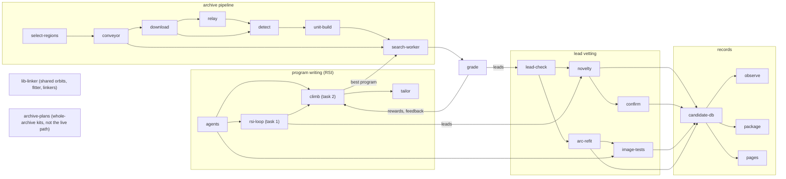

# DECam RSI pipeline: AI agents write the search, the archive pipeline runs it, every lead is vetted

**Status: private snapshot of the code as it ran (2026-11-24). Paths, logins, accounts, hosts and private pages are replaced by placeholders, listed in [CONFIG.md](CONFIG.md); sites are described in [NODES.md](NODES.md).**
Nothing was refactored for this snapshot. It is meant to be read, not run: the code needs our clusters, logins, storage
and data, none of which are here.

## What the system is

A search for large distant Solar System bodies (about 200 km and up, 30-1,000 au) in every public exposure of the Dark
Energy Camera (DECam, 2013-2026), in three parts:

1. **An AI hill climb writes the search program.** In rounds, coding agents (Claude Fable 5.2 through Claude Code; GPT 6 /
   6.2 Astra through Codex; Claude Opus 5.5 in the first task) each get every earlier program with its reward and feedback,
   write a new `finder.py` in a sandbox with no GPU and no web, and the program is graded on GPUs against known bodies it
   was never told how to find. The best program so far is kept. This is recursive self-improvement in the narrow sense of
   the benchmark it came from: the agents improve the program, the grader decides. Two tasks ran this way:
   - task 1 (`nodes/rsi-loop`, "planet-search"): raw images of one sky patch over days to weeks, 10 sealed fields;
   - task 2 (`nodes/climb`, "decam-big-tno"): one 5 % search region's own single-exposure detection lists over all
     years (tens of millions of detections), graded by recall of known bodies and by GPU-hours.
2. **The archive pipeline runs the latest best program over DECam**, 5 % of the sky at a time: choose the sky, download
   and relay the images, detect sources in each exposure, build each region's scenario, and search every region on one
   GPU each (NERSC A100, TACC Vista GH200/GB200) with whatever program is best when the region starts (`nodes/conveyor`).
3. **Every lead goes through novelty and confirmation checks**: an in-data repeat test, arc extension across years, a
   fixed-source test, a search of everything the Minor Planet Center and SkyBoT know that moves like it (one orbit fitted
   through both data sets), and image tests in other archives; promising bodies go into a candidate database.

## How to read this repository

| Path | What |
|---|---|
| `NODES.md` | one section per node: purpose, code, inputs and outputs with their JSON fields, settings, where it ran, what is hard-coded, and what to change to swap it (another model, archive, cluster, grader or check) |
| `pipeline.yaml` | the same registry in machine form (id, purpose, implementation, inputs, outputs, config, site, hardcoded counts and examples, downstream nodes) |
| `nodes/<node>/` | the code of each node, copied as it ran; inside a node the original folder layout is kept (`planet-search/...`, `decam-big-tno/...`, `conveyor/...`) |
| `SOURCES.tsv` | every file in `nodes/`: its original path in our project tree and its size |
| `programs/` | every generation's submitted program of both tasks and all four runs (325 programs), with `programs/INDEX.md` (run, generation, model, public reward, size) |
| `nodes/conveyor/PIPELINE.md` | the operators' map of the live pipeline as it stood on 2026-11-21 (stages, logs, stop files, restarts) |
| `nodes/rsi-loop/planet-search/rsi/REFERENCE_SOLVER.md` | task 1's best program, used as the reference solver, and what it does stage by stage |

Start with this file, then `NODES.md` in data-flow order. The entry points of the live system were `conveyor.py loop 3`
(archive pipeline), `climb.py run --run r2` (the hill climb), `novelty_watch.py` and `confirm_watch.py` (vetting
queues) and `candidates/refresh.sh` (records).

## Results at the snapshot (public rewards only)

| Task, run | Agent model | Generations | Best public reward |
|---|---|---|---|
| task 1 (planet-search) r1 | Claude Opus 5.5, xhigh | 188 programs | 0.2707 (weighted recall points, 10 sealed fields; KBMOD baseline 0.015) |
| task 1 (planet-search) r2 | Claude Fable 5.2, xhigh | 24 programs | 0.3985 |
| task 2 (decam-big-tno) r1 | Claude Fable 5.2, xhigh | 37 programs | 0.6061 (weighted recall of known bodies, 3 regions) |
| task 2 (decam-big-tno) r2 | Claude Fable 5.2 and GPT 6 / 6.2 Astra | 76 programs | 0.8383 recall at 1.89 GPU-hours (4 regions; gen000 = r1's gen019 at 0.479) |

## What is not here, and why

- **Data of any kind**: images, detection lists, scenarios, labels and truth, known-body tables, region and exposure
  lists, download manifests, transfer records. They live on our storage and clusters; the code names where.
- **Sealed answers and results**: grades (`grade.json`), per-scenario and per-body results, leads, candidate tables,
  positions, dates and orbits of unreported bodies, our MPC filings, and the per-candidate hand records of the image tests
  (redacted to empty literals in `imagetests_build.py`; `record_add.py` left out).
- **Agent records**: transcripts, traces, the agents' own `NOTES.md` and test outputs inside their programs, run logs.
- **Secrets**: no keys, tokens or credential files were opened or copied; the model relay and the cluster logins hold
  them outside this tree.
- **The trial host's runner** (`run_trial.sh`, queue and pressure guard) that starts Harbor trials: a separate private
  repository; `climb.py` shows how it was called.

Names of people (the author's included), email addresses, our MPC tracklet names, message ids, a client's name, logins,
allocations, host names, user-id paths, Globus ids, Slurm job ids, the model relay's address, private page URLs, scenario
ids and the ids of held-out regions were replaced by neutral placeholders (`PROJECT_LEAD_NAME`, `OBSERVER_NAME`,
`$NERSC_USER`, `$NERSC_SCRATCH`, `$VM_HOST`, `$RELAY_ADDR`, `<private-page-url>`, `scen03`, `REG_A`, `TRKSUB01`, ...);
[CONFIG.md](CONFIG.md) says what each one stands for. Quotes of the project lead's instructions in comments were cut to
their dates. One module was renamed because a person's name was in its file name: it is now
`nodes/package/decam-big-tno/harness/observer_batch.py`, and the two imports of it were changed to match. The builder of
the team's status site is `nodes/pages/pages/team-site/`.

## Before an open-source release

The code still expects our sites (NERSC Perlmutter, TACC Vista and Lonestar6, a cloud VM, a macOS workstation) and our
folder layout; set the placeholders of [CONFIG.md](CONFIG.md) to your own values. `pipeline.yaml` counts the hard-coded
paths, accounts and hosts per node as they were before the placeholders (the examples there are placeholders too).

Author: the ALE Astronomy team, with Claude agents (Claude Code) that wrote and ran most of this code.
